# PathSnap — Map-Matching and Route Reconstruction

**UE24CS352A Machine Learning Hackathon — Technical Report**

Team: Nishit D B (lead), Mahesh Kumar, Madhav, Nishanth T  
Repository: https://github.com/Crossbow2560/ml-hackathon

Every table in this report is generated from the result files in the repository by `report/make_tables.py`
(`python -m report.build_report` rebuilds this PDF). Partitions: **train** = 80 trips, **student_test** = 10 trips.
The evaluator partition was never used for any analysis, training, tuning or selection.

## 1. Approach in one paragraph

Each GPS point is matched to the road network in two stages. (1) A **candidate scorer** looks at every directed road
segment (arc) within 50 m of the point and predicts the probability that it is the arc the vehicle was on, from 16
geometry-relative features. (2) A **Hidden Markov Model** decodes the whole trip with Viterbi so that consecutive
points are assigned to arcs that are actually connected in the road network. Our two departures from the standard
recipe are (a) a **learning-to-rank** candidate scorer (LightGBM LambdaRank, one ranking query per GPS point) and
(b) a **learned HMM transition model** (logistic regression on pairs of candidate arcs) instead of the textbook
exponential formula. Together they raise student-test Top-1 accuracy from 0.850 (best hand rule, Table 2.7) to
**0.946** (Table 5.4).

## 2.2 Dataset Understanding and Exploratory Data Analysis

### Data organisation

One folder per trip, four header-less whitespace-separated files: `.track` (longitude, latitude, time in s),
`.nodes` (longitude, latitude; row index = node id), `.arcs` (from-node, to-node; row index = arc id, directed) and
`.route` (the ordered arc ids the vehicle drove). Two facts shaped the whole design:

* **Every trip has its own local road network.** Node and arc ids only mean something inside one trip and the trips
  are spread over the world (Figure 2.4). Features therefore must be geometry-relative; ids and absolute
  coordinates are never used as features.
* **The route file gives no per-point labels.** It lists the arcs in driving order but not which GPS point lies on
  which arc, so we derive labels ourselves (preprocessing step 3).

{{table:dataset_overview}}

*Table 2.1 — dataset inventory and summary statistics per partition (`results/analysis/*/`).*

### How we preprocessed the data

1. **Validation.** Phase 0 scripts (`scripts/analysis/00–05`) check every file: presence, column counts, dtypes,
   NaN/inf, coordinate ranges, a longitude/latitude swap test against the network bounding box, duplicate and
   non-monotonic timestamps, gaps, speeds, invalid arc references, self-loops, connectivity and route continuity.
   Table 2.2 (train and student_test) shows that the raw data is clean — no row had to be dropped or repaired.
2. **Projection.** Longitude/latitude are angles, so each trip is projected into its own UTM zone (metres,
   `pathsnap/geo.py`). All distances, bearings and point-to-segment projections are computed in metres.
3. **Labels by monotonic alignment** (`pathsnap/labels.py`). Every GPS point *i* gets a route position *j(i)* with
   *j* never decreasing over time, minimising the total point-to-arc distance (dynamic programming with a running
   prefix minimum, O(points × route arcs)). The label is the arc at that position. Points more than 50 m from their
   label arc are flagged **unreliable** and excluded from training and every metric (Table 2.5).
4. **Candidates** (`pathsnap/candidates.py`). All directed arcs within R of the point, nearest K kept. Both
   directions of a two-way road are separate candidates at the same distance. R = 50 m and K = 30 were chosen from
   the miss-rate study in Table 2.6.

{{table:missing_values}}

*Table 2.2 — missing / invalid value analysis (train and student_test, `results/analysis/*/track_issues.csv`).*

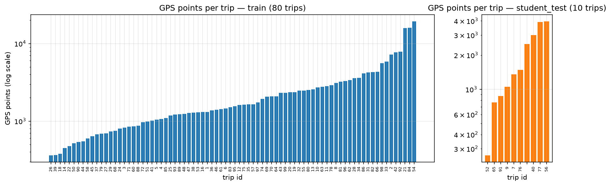

*Figure 2.1 — GPS points per trip (train and student_test).*

### Patterns observed

* **Sampling.** Tracks are ~1 Hz (Table 2.1), but 22 train trips have at least one gap > 60 s (largest 42.5 h,
  trip 90) → the HMM splits the chain at gaps longer than 60 s (Figure 2.2).

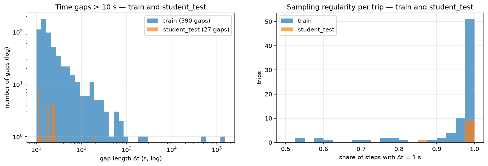

*Figure 2.2 — time gaps > 10 s and the share of exactly-1 s steps per trip (train and student_test).*

* **Two-way roads.** In most networks over 90 % of arcs have a reverse twin (Figure 2.3). Both directions lie on
  the same line, so distance alone cannot pick the right one — the plain nearest arc is correct for only
  ~55 % of points (Table 2.7). This is why heading features are central.

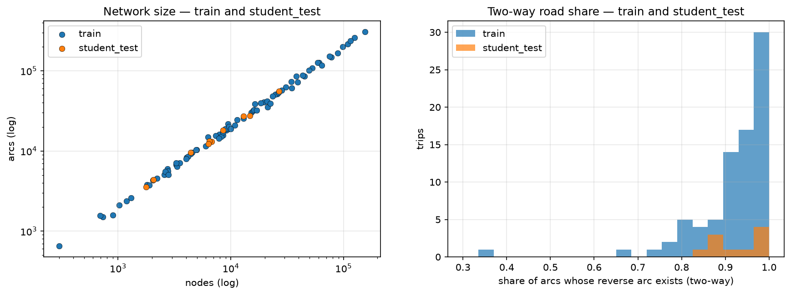

*Figure 2.3 — road-network size and share of two-way arcs (train and student_test).*

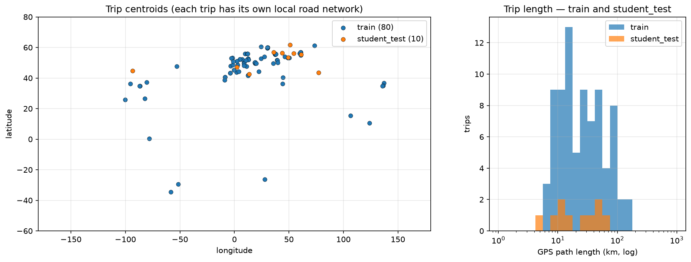

*Figure 2.4 — trip centroids and trip lengths (train and student_test). Each trip has its own local network.*

* **GPS noise.** The median distance from a GPS point to the reference route is ~5 m, but a few trips have long
  stretches far from it (Table 2.3, Figure 2.5).

{{table:gps_noise}}

*Table 2.3 — distance from GPS points to the reference route (every 5th point) and the naive nearest-arc baseline.*

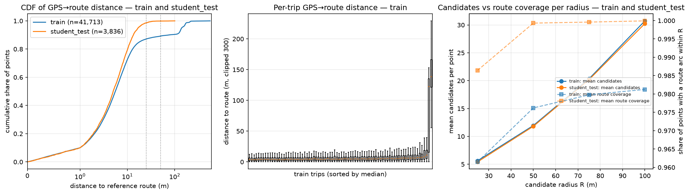

*Figure 2.5 — CDF of GPS→route distance, per-trip distribution (train) and candidates vs coverage per radius.*

* **The reference route is not perfect ground truth.** Four train trips have > 5 % of points more than 50 m from
  the route. Folium maps showed two different causes: in trips 33 and 54 the vehicle stays for most of the trip in
  a ~1 km area with no mapped road (off-network dwell, e.g. parked), in trips 2 and 43 the drive and the route
  disagree along the trip. 10 train routes also contain small breaks (continuity ≥ 0.981, Figure 2.6).

{{table:far_trips}}

*Table 2.4 — train trips with many far-off points and their cause.*

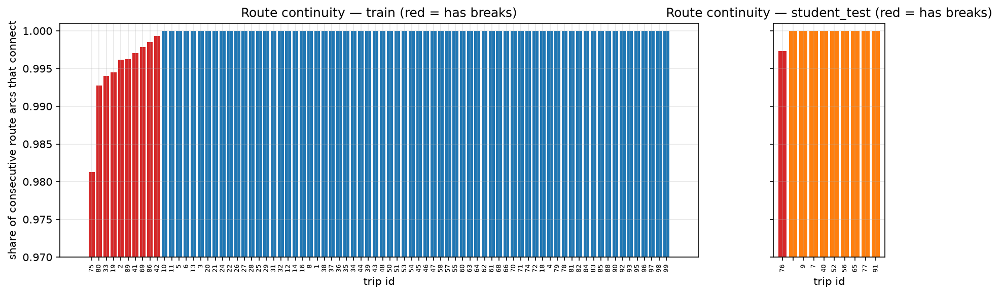

*Figure 2.6 — reference-route continuity per trip (train and student_test).*

{{table:label_summary}}

*Table 2.5 — derived labels (both partitions). At 1 Hz short arcs are often skipped between two points, so even the
true per-point label sequence is only ~92 % continuous; route continuity is therefore measured on the stitched route.*

{{table:candidate_study}}

*Table 2.6 — candidate miss rate (true arc not among the candidates) vs radius and cap (train). R = 25 m misses
~3.6 % of points; K = 20 still misses ~1 % on dense networks; R = 50 m with K = 30 misses 0.04 % at ~8.5 candidates
per point. Points beyond 50 m are unreliable by definition, so the case against R > 50 m is cost.*

### Features and why we chose them

{{table:feature_table}}

* **Distance features** (distance, rank, gap to the nearest candidate, soft-min share) capture GPS noise *relative to
  the other candidates*, which transfers across networks better than raw distance.
* **Heading vs arc bearing** separates the two directions of a road; the GPS heading is smoothed over 5 points and
  flagged invalid when the vehicle barely moved (stops).
* **Window distances** (points *i−3…i+3*) reward arcs the vehicle stays close to over several seconds.
* **Arc / junction attributes** (length, two-way, degrees) describe how ambiguous the neighbourhood is.

{{table:rule_baselines}}

*Table 2.7 — non-learned baselines. Adding a heading rule lifts Top-1 from ~0.55 to ~0.85; every model below must
beat this.*

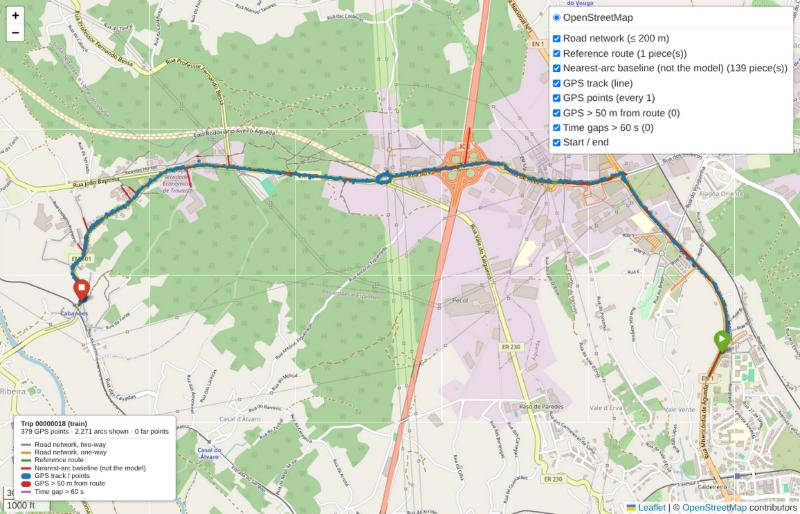

*Figure 2.7 — Folium map of train trip 18 (raw data): GPS track and points (blue), nearby road network (grey/orange),
reference route (green) and the naive nearest-arc baseline (red), which breaks into 139 pieces by jumping to side
streets and crossing roads. Generated by `scripts/make_maps.py --pick4 --nearest-baseline`.*

## 3. Model Experimentation and Comparison

**Set-up (identical for every model).** Rows are (GPS point, candidate arc) pairs with a binary label
(1,772,015 rows in the train table before unreliable points are removed). 5-fold **GroupKFold by trip** on the 80 train trips (a trip never spans folds), then a refit on
all train trips and evaluation on the 10 student-test trips. Unreliable points are removed. No class weighting
(the HMM needs honest probabilities). Seed 42. Metrics: candidate-level macro-F1 at threshold 0.5 (the required CV
metric), observation-level **Top-1 accuracy** (is the highest-scoring candidate the true arc — the quantity map
matching actually needs), log loss (probability quality, used by the HMM), route continuity of the classifier-only
route, and inference time. Code: `pathsnap/models.py`, `scripts/train_models.py`, `scripts/plot_models.py`.

**Primary selection metric.** CV macro-F1 (as required) with Top-1 and log loss as tie-breakers: Top-1 is what the
evaluator sees and log loss determines how useful the scores are as HMM emissions.

### 3.1 Overall model comparison

{{table:model_comparison}}

*Table 3.1 — all models (CV on train, Top-1 / F1 / log loss / continuity / inference on student_test).*

{{table:model_fit}}

*Table 3.2 — train vs cross-validation vs student-test, used for the over/underfitting answers below.*

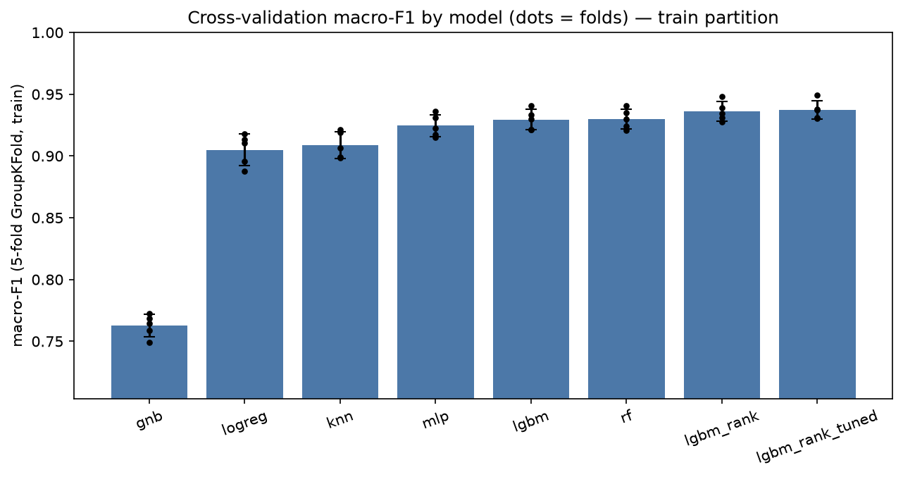

*Figure 3.1 — CV macro-F1 per model, mean ± sd over 5 folds (dots = folds), train partition.*

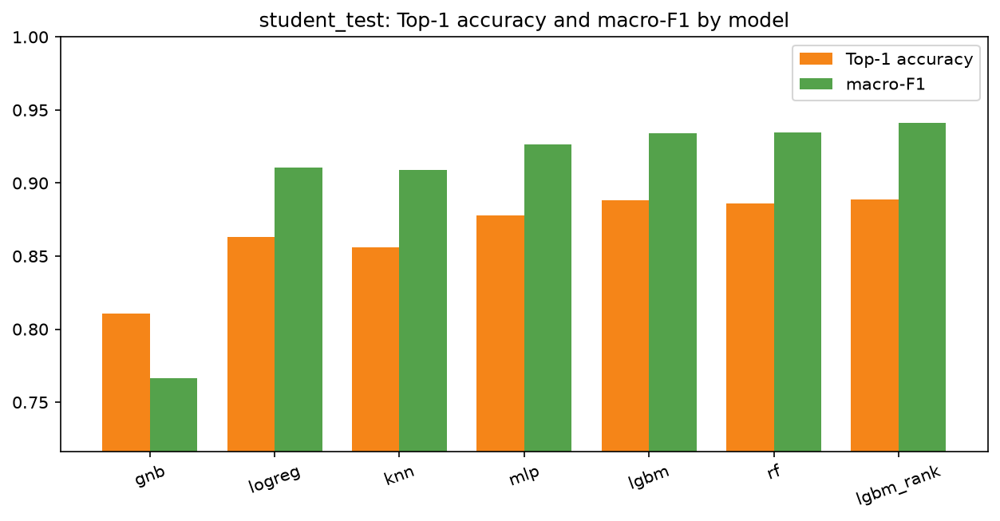

*Figure 3.2 — student-test Top-1 accuracy and macro-F1 per model.*

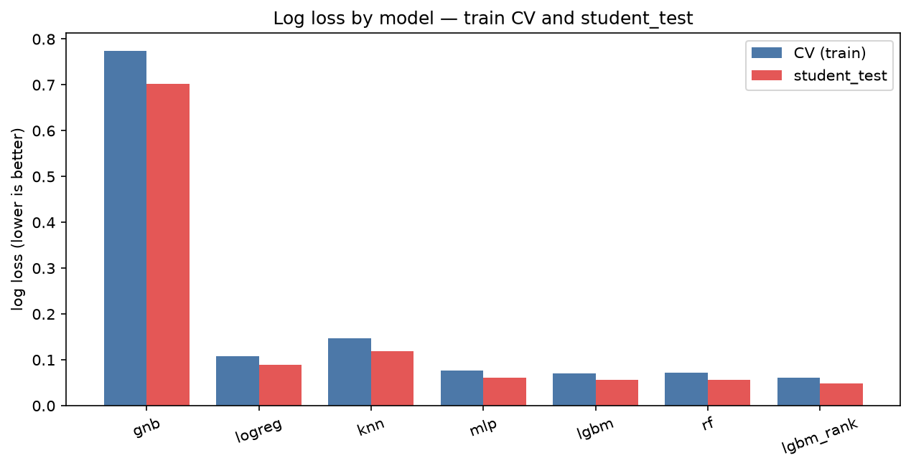

*Figure 3.3 — log loss per model (CV and student_test).*

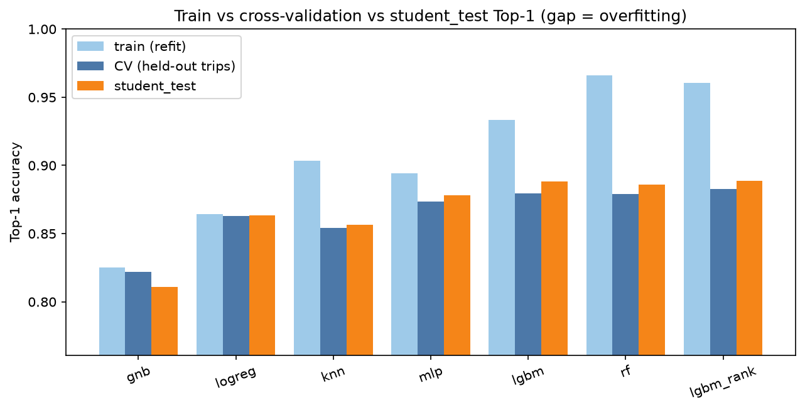

*Figure 3.4 — train vs CV vs student-test Top-1: the gap measures overfitting.*

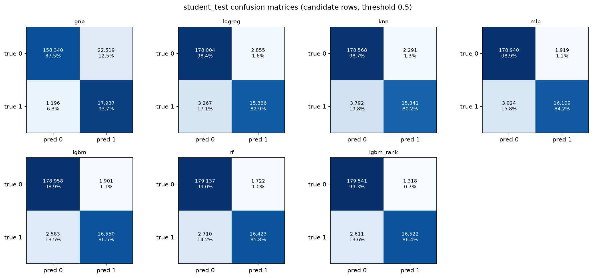

*Figure 3.5 — student-test confusion matrices (candidate rows, threshold 0.5).*

### 3.2 Per-model questions

#### Model 1 — Logistic Regression (linear)

- **A1. Why suitable.** A calibrated linear baseline: if "close, same direction, consistent over the window" were
enough, a weighted sum would already do well, and its probabilities are directly usable as HMM emissions.
- **A2. Strengths / limitations.** Fast ({{v:logreg:train_time_s:.1f}} s fit, {{v:logreg:infer_ms_per_1k_obs:.2f}} ms per
1,000 points) and interpretable, but it can only draw one linear boundary; interactions such as "heading matters only
when the vehicle moves" are out of reach.
- **B5. Hyperparameters.** C = 1.0 (L2), max_iter = 1000, features standardised.
- **B6. Objective.** Binary cross-entropy (log loss) with L2 penalty.
- **C7–8. Student-test performance.** Top-1 {{v:logreg:st_top1}}, macro-F1 {{v:logreg:st_macro_f1}}, log loss
{{v:logreg:st_log_loss}}.
- **C9. Fit.** Train Top-1 {{v:logreg:train_top1}} ≈ CV {{v:logreg:cv_top1}} ≈ test {{v:logreg:st_top1}} — no
overfitting, but it **underfits**: it barely beats the 0.85 heading rule and stays ~0.025 below the tree models.

#### Model 2 — Gaussian Naive Bayes (probabilistic)

- **A1. Why suitable.** The simplest generative model; a check on whether per-feature likelihoods are enough.
- **A2. Strengths / limitations.** Trains in {{v:gnb:train_time_s:.2f}} s, but assumes independent, Gaussian features.
Our features are strongly dependent (distance, rank, soft-min share and window distances describe the same thing),
so evidence is counted several times and probabilities are pushed to 0 or 1.
- **B5. Hyperparameters.** var_smoothing = 1e-9 (default); no other hyperparameters.
- **B6. Objective.** Maximum-likelihood class-conditional Gaussians (no iterative loss).
- **C7–8.** Top-1 {{v:gnb:st_top1}}, macro-F1 {{v:gnb:st_macro_f1}}, log loss {{v:gnb:st_log_loss}} — the worst model and
the only one below the heading rule. Its recall is high ({{v:gnb:st_recall:.3f}}) but precision is
{{v:gnb:st_precision:.3f}}: many wrong candidates get a confident "yes" (Figure 3.5).
- **C9. Fit.** Train ≈ CV ≈ test ({{v:gnb:train_top1}} / {{v:gnb:cv_top1}} / {{v:gnb:st_top1}}): clear **underfitting** due
to the wrong independence assumption, not overfitting.

#### Model 3 — K-Nearest Neighbours (instance-based)

- **A1. Why suitable.** Similar geometric situations (distance, heading, density) should have similar answers.
- **A2. Strengths / limitations.** No training, flexible boundary, but sensitive to scaling and very slow to predict:
{{v:knn:infer_ms_per_1k_obs:.0f}} ms per 1,000 points — 30–50× slower than the boosted models, too slow for the API.
Fitted on a 200,000-row stratified sample for this reason.
- **B5. Hyperparameters.** k = 15, distance weighting, Euclidean on standardised features.
- **B6. Objective.** None (lazy learner; vote weighted by inverse distance).
- **C7–8.** Top-1 {{v:knn:st_top1}}, macro-F1 {{v:knn:st_macro_f1}}, log loss {{v:knn:st_log_loss}}.
- **C9. Fit. Overfitting:** train Top-1 {{v:knn:train_top1}} vs CV {{v:knn:cv_top1}} (with distance weighting a stored
training point is its own nearest neighbour), and the worst calibrated of the strong models.

#### Model 4 — Random Forest (bagging ensemble)

- **A1. Why suitable.** Captures non-linear interactions (heading only matters when moving; distance matters relative
to the neighbours) and is robust to feature scale.
- **A2. Strengths / limitations.** Strong and stable across folds (sd {{v:rf:cv_macro_f1_std}}), but the slowest to train
({{v:rf:train_time_s:.0f}} s) and the saved model is ~0.8 GB.
- **B5. Hyperparameters.** 300 trees, min_samples_leaf = 5, max_features = √16.
- **B6. Objective.** Gini impurity per split; bootstrap aggregation.
- **C7–8.** Top-1 {{v:rf:st_top1}}, macro-F1 {{v:rf:st_macro_f1}}, log loss {{v:rf:st_log_loss}}.
- **C9. Fit. Overfitting:** train Top-1 {{v:rf:train_top1}} vs CV {{v:rf:cv_top1}}; deep trees memorise training trips,
although generalisation is still good.

#### Model 5 — LightGBM (gradient boosting, binary)

- **A1. Why suitable.** Gradient boosting is the usual best choice for tabular features of mixed scale.
- **A2. Strengths / limitations.** Accurate and fast ({{v:lgbm:train_time_s:.0f}} s fit,
{{v:lgbm:infer_ms_per_1k_obs:.0f}} ms per 1,000 points), but it scores each candidate independently — it does not know
that exactly one candidate per point is correct.
- **B5. Hyperparameters.** 400 trees, learning rate 0.05, 63 leaves, min_child_samples 50.
- **B6. Objective.** Binary log loss.
- **C7–8.** Top-1 {{v:lgbm:st_top1}}, macro-F1 {{v:lgbm:st_macro_f1}}, log loss {{v:lgbm:st_log_loss}}.
- **C9. Fit.** Moderate overfitting: train {{v:lgbm:train_top1}} vs CV {{v:lgbm:cv_top1}}.

#### Model 6 — Multi-layer Perceptron (neural network)

- **A1. Why suitable.** Learns smooth non-linear interactions of the standardised features.
- **A2. Strengths / limitations.** Fast inference ({{v:mlp:infer_ms_per_1k_obs:.1f}} ms per 1,000 points), but needs
scaling, more tuning and was slightly below the boosted trees.
- **B5. Hyperparameters.** Hidden layers (64, 32), ReLU, Adam (lr 0.001), L2 α = 0.0001, batch 2048, up to 50 epochs,
early stopping with patience 5 on 10 % of train trips held out.
- **B6. Objective.** Binary cross-entropy.
- **C7–8.** Top-1 {{v:mlp:st_top1}}, macro-F1 {{v:mlp:st_macro_f1}}, log loss {{v:mlp:st_log_loss}}.
- **C9. Fit.** The only model with an epoch history (Figure 3.6): training loss keeps falling while validation loss
flattens at ≈0.071 after epoch ~5 and is lowest at epoch 17; training stopped at epoch 22 and the best epoch was
restored. Train {{v:mlp:train_top1}} vs CV {{v:mlp:cv_top1}}: mild overfitting, controlled by early stopping.

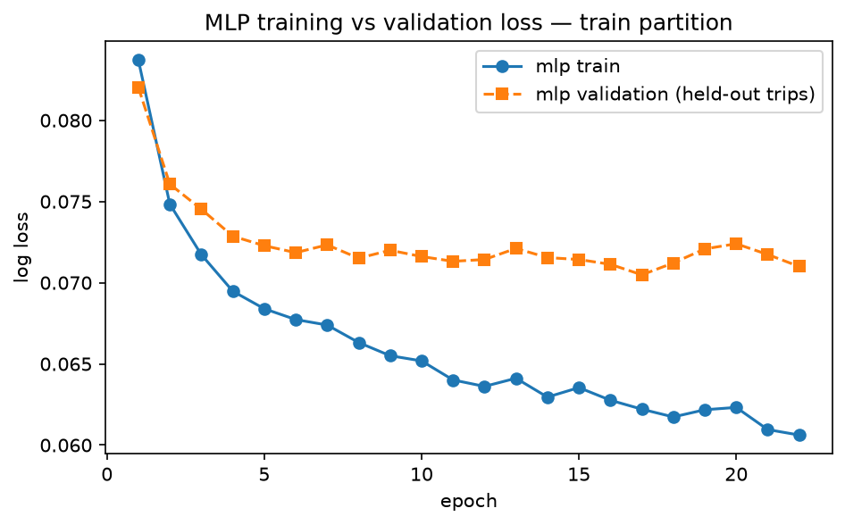

*Figure 3.6 — MLP training vs validation log loss per epoch (train partition, validation = held-out trips).*

#### Model 7 — LightGBM LambdaRank (learning-to-rank) — selected

- **A1. Why suitable.** Map matching is a *ranking* problem: for each GPS point exactly one candidate is right.
LambdaRank uses one query group per point and optimises the order of candidates within the group, which is what
Top-1 measures. Scores are turned into probabilities with a per-point softmax for the HMM.
- **A2. Strengths / limitations.** Best on every metric with a fast fit ({{v:lgbm_rank:train_time_s:.0f}} s); it needs
group-sorted data and its raw scores are not probabilities (handled by the softmax).
- **B5. Hyperparameters.** 400 trees, learning rate 0.05, 63 leaves, min_child_samples 50.
- **B6. Objective.** LambdaRank (NDCG-weighted pairwise loss within each GPS point).
- **C7–8.** Top-1 {{v:lgbm_rank:st_top1}}, macro-F1 {{v:lgbm_rank:st_macro_f1}}, log loss {{v:lgbm_rank:st_log_loss}},
classifier-only route continuity {{v:lgbm_rank:st_route_continuity:.3f}} (best of all models).
- **C9. Fit.** Overfits like the other tree models (train {{v:lgbm_rank:train_top1}} vs CV {{v:lgbm_rank:cv_top1}}) —
the reason the Bayesian search below includes regularisation parameters.

**Selection.** LambdaRank has the highest CV macro-F1, CV and student-test Top-1, the lowest log loss and the best
continuity, a stable fold spread and fast inference — and its objective matches the task. It was tuned next.

## 4. Bayesian Hyperparameter Optimisation (LambdaRank)

* **Method.** Optuna TPE sampler (seed 42), `scripts/tune_optuna.py`.
* **Objective.** Mean macro-F1 over GroupKFold(5) on the train trips (Top-1 recorded too). student_test was not used
  during the search.
* **Trials.** {{j:results/optuna/search_space.json:n_trials:d}} trials:
  {{j:results/optuna/search_space.json:n_complete:d}} completed, {{j:results/optuna/search_space.json:n_pruned:d}} stopped
  by a median pruner after the first folds. Search time {{j:results/optuna/search_space.json:search_seconds:.0f}} s.
* **Cost control.** Each trial used every 4th GPS point per trip (consecutive 1 Hz points are near-duplicates):
  {{j:results/optuna/search_space.json:search_rows:,}} rows.

{{table:hpo_space}}

*Table 4.1 — search space.*

{{table:hpo_best}}

*Table 4.2 — initial vs best values. The search chose much smaller trees (15 leaves), a slower learning rate and row
/ column subsampling — i.e. more regularisation.*

{{table:tuned_vs_untuned}}

*Table 4.3 — untuned vs tuned on the same partitions and metrics.*

**Did tuning help?** Only slightly in accuracy (CV macro-F1 {{v:lgbm_rank:cv_macro_f1_mean}} →
{{v:lgbm_rank_tuned:cv_macro_f1_mean}}, student-test Top-1 {{v:lgbm_rank:st_top1}} → {{v:lgbm_rank_tuned:st_top1}}), at the
cost of slightly worse student-test log loss and a few ms of inference time. The clear gain is generalisation: the
train-vs-CV Top-1 gap fell from ≈0.078 to ≈0.022. We kept the tuned model for the HMM because it overfits much less.

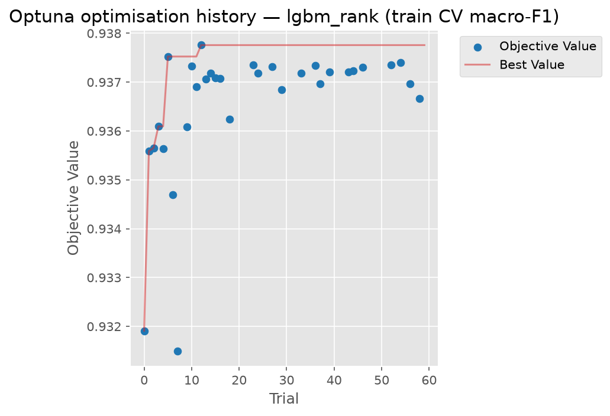

*Figure 4.1 — optimisation history (train CV macro-F1 per trial).*

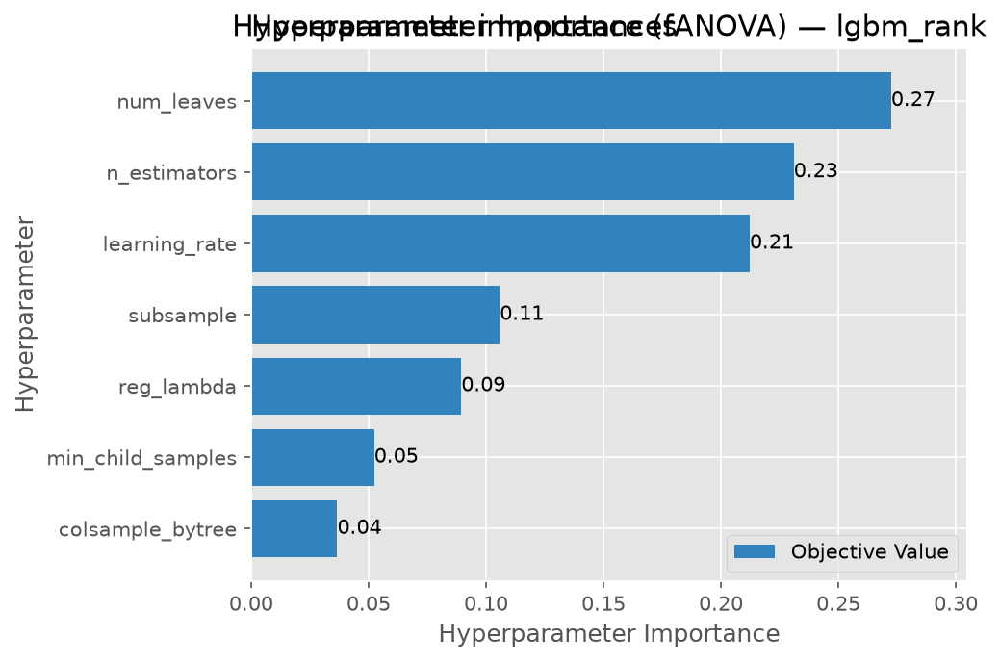

*Figure 4.2 — hyperparameter importance (fANOVA).*

## 5. HMM and Viterbi Route Reconstruction

Code: `pathsnap/hmm.py`, `pathsnap/transitions.py`, `pathsnap/graph.py`, `scripts/train_transitions.py`,
`scripts/tune_decoder.py`, `scripts/evaluate_hmm.py`.

**1. Hidden states.** At each GPS point the hidden state is one of its candidate arcs (≤ 30), stored with its
projection position along the arc. The candidate ↔ arc id correspondence is kept throughout, so the decoded state is
directly a road segment.

**2. Emissions.** log E_t(j) = α · log p_t(j), where p is the tuned LambdaRank probability renormalised over the
point's candidates; α weights emissions against transitions.

**3. Transitions.** For consecutive points (t−1, t) and candidates a, b we compute the shortest *driving* distance
d_route from the position on a to the position on b (bounded Dijkstra on the directed graph, limit
v_max·Δt + 2R with v_max = 50 m/s) and the straight GPS displacement d_gc. Two models:

* *Exponential (baseline, Newson & Krumm):* log T = −|d_route − d_gc| / β.
* *Learned (ours):* logistic regression on 8 pair features — |d_route − d_gc|, log ratio, implied speed, Δt, same arc,
  U-turn, turn angle, log d_route — trained on {{j:results/hmm/transition_model.json:train_pairs:,}} candidate pairs
  from train trips (positive = true consecutive pair). log T = γ · log P(true pair). It uses geometry only, never
  classifier scores, so it cannot leak labels into the emissions.

{{table:transition_eval}}

*Table 5.1 — the learned transition separates true from false pairs much better than the exponential score
(ROC-AUC), and ranks the true pair first more often.*

{{table:transition_coef}}

*Table 5.2 — learned coefficients (standardised features): a large |d_route − d_gc|, sharp turns and implausible speed
are penalised, staying on the same arc is rewarded. The positive U-turn coefficient is unexpected; it most likely
reflects stops, where GPS jitter makes the vehicle appear to reverse onto the twin arc.*

**Viterbi recurrence.** δ_t(j) = log E_t(j) + max_i [δ_{t−1}(i) + log T(i, j)], with back-pointers; the path is read
backwards. Forward-backward (log-space, normalised per step) gives each point a posterior **confidence**, shown in the UI.

**4. Missing candidates and large gaps.** Points without any arc within 50 m have no state: they are skipped (output
"no match") and the chain continues to the next point. If Δt > 60 s the chain is split and decoding restarts, so the
HMM never forces a path through an unknown gap.

**5. Disconnected segments.** If no candidate at t is reachable from any candidate at t−1, the chain is split there
instead of producing −∞ everywhere. During development this exposed a real problem: slow or stopped vehicles produce
GPS fixes that step slightly *backwards*, which a forward-only distance treats as a loop around the block
(unreachable). Before the fix the HMM scored *below* the classifier on the tuning trips and some trips were split
into dozens of pieces. We now allow backward moves of up to 20 m along the same arc or onto the preceding arc in the
same direction (never onto the opposite-direction twin), after which the splits disappeared. Finally, consecutive
decoded arcs that are not adjacent are joined with the shortest path to give a continuous route.

**Decoder weights.** α and β / γ were tuned with Optuna (40 trials each) on 30 random train trips using the scorer's
**out-of-fold** probabilities, so the decoder was tuned on scores the scorer never trained on. The learned variant was
chosen for deployment from these train results.

{{table:decoder_params}}

*Table 5.3 — tuned decoder weights (train, out-of-fold scores).*

**6. Did the HMM improve the route? Yes.**

{{table:hmm_comparison}}

*Table 5.4 — classifier-only vs classifier + HMM on student_test (point-weighted over the 10 trips). Reference labels
give the ceiling for continuity and route F1.*

{{table:hmm_per_trip}}

*Table 5.5 — Top-1 per student-test trip.*

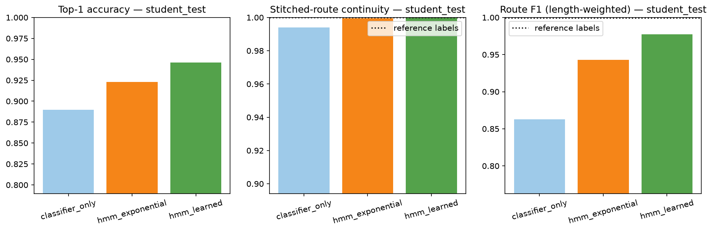

*Figure 5.1 — Top-1, stitched-route continuity and route F1 (student_test).*

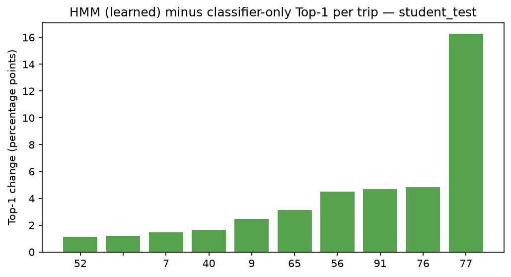

*Figure 5.2 — Top-1 gain of the learned HMM over classifier-only per trip (student_test).*

**Improvements.** The learned HMM raises Top-1 on every student-test trip; the largest gain is trip 77
(0.750 → 0.913), where the classifier alone keeps switching to parallel and opposite-direction arcs. Route precision
rises from 0.767 to 0.957 because spurious side-street arcs disappear, and point continuity moves from 0.798 towards
the 0.932 ceiling of the true labels.

**Where the HMM did not help.**

* The textbook exponential transition is slightly *better* than the learned one on 4 of 10 trips (0, 7, 9, 52 —
  differences ≤ 0.009); the learned model wins overall because of large gains on harder trips (77, 91, 76).
* **Calibration got worse:** HMM posteriors are much more confident than the classifier (log loss 0.134 vs 0.052):
  the tuned weights (α ≈ 3.1, γ ≈ 3.8) sharpen the distribution. Decisions are more accurate, but the confidence values
  shown in the UI overstate certainty.
* Off-network dwell (e.g. a parked vehicle away from any mapped road) cannot be fixed by any decoder — there is no
  correct arc to choose.

## 6. Geographical Visualisation Using Folium

Maps are generated from our implementation by `pathsnap/viz.py` (`trip_map`), `scripts/make_maps.py`,
`scripts/analysis/06_visualise_trip.py` and `scripts/evaluate_hmm.py`; the interactive HTML maps are in
`results/maps/` and `results/hmm/maps/`. Every map has separate, toggleable layers (layer control), a legend, distinct
colours (GPS blue, road network grey/orange, reference route green, predicted route red, far-off points red dots,
time gaps purple dashed), start/end markers and is zoomed to the trip.

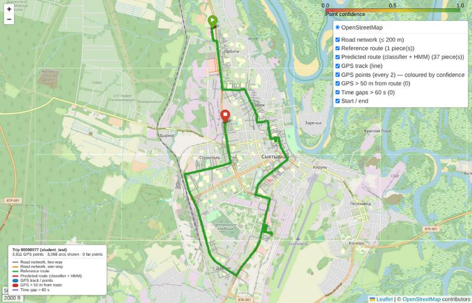

*Figure 6.1 — student-test trip 77: road network, reference route (green), predicted route of classifier + learned
HMM (red) and GPS points coloured by HMM confidence.*

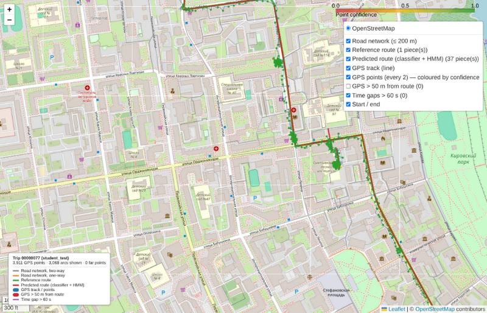

*Figure 6.2 — zoomed detail of trip 77: the predicted route (red) lies on the reference route (green) through the
street grid; one short spur near the top shows a remaining disagreement.*

Figure 2.7 (Section 2.2) shows the raw data and the naive nearest-arc baseline for comparison.

## 7. API, UI and Deployment

* **Laptop 1 — API** (`api/main.py`, FastAPI): `GET /health`, `GET /trips` (the 10 evaluation trips) and
  `POST /match {trip_id}`, which runs `pathsnap.pipeline.match_trip` (candidates → features → LambdaRank →
  HMM → stitched route; never opens `.route`) and then `score_trip` (the only code that reads `.route`). The reference
  route never leaves Laptop 1. Each request is printed with time, client IP, trip, status, duration and the scores.
* **Laptop 2 — UI** (`ui/app.py`, Streamlit): API address and connection check, trip picker, folium map (raw GPS,
  predicted route, confidence-coloured points), metric cards, server timings and low-confidence stretches. It only
  talks to the API over HTTP. Setup steps are in the README ("Two-laptop deployment").
* **Artifacts** (`scripts/export_artifacts.py`): `artifacts/classifier.joblib` (1.2 MB), `transition.joblib`,
  `pipeline_config.yaml`, `feature_list.json`. A full student-test trip takes 0.2–3.3 s on Laptop 1.

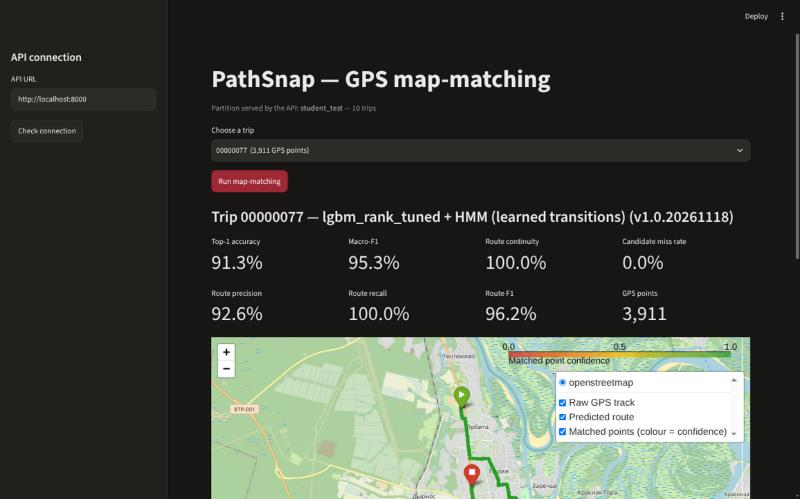

*Figure 7.1 — the UI after running trip 77 (rehearsal with student_test).*

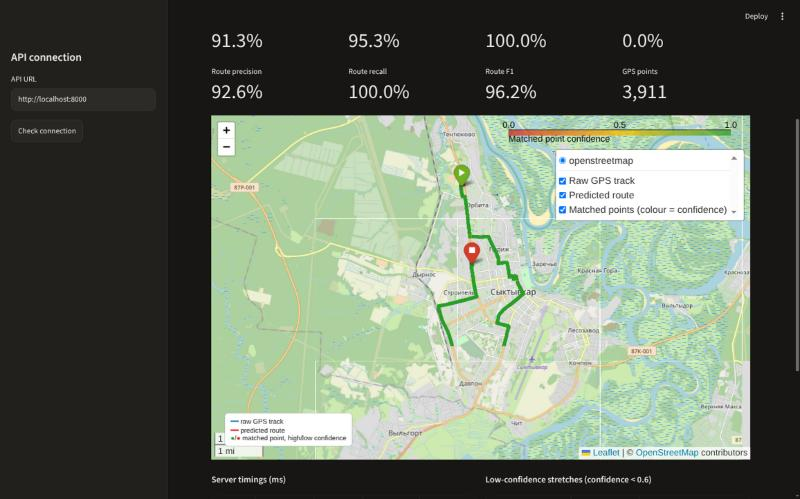

*Figure 7.2 — the UI map for trip 77.*

API console on the receiving laptop during that rehearsal:

```
PathSnap API starting — partition=student_test mock=False
loaded model: lgbm_rank_tuned + HMM (learned) v1.0.20261118
127.0.0.1 GET /trips trip=- status=200 7 ms
  trip 00000077: 3911 points | top1=0.913 macro_f1=0.953 continuity=1.000 route_f1=0.962 | total 2774 ms
127.0.0.1 POST /match trip=00000077 status=200 2946 ms
```

## 8. Conclusions

A learning-to-rank candidate scorer plus an HMM with a learned transition model reconstructs routes with 0.946
point-level Top-1 accuracy and 0.977 route F1 on the student-test trips, against 0.850 for the best hand rule and
0.890 for the scorer alone. The most important lessons were data-driven: labels had to be derived because the route
gives none, direction (two-way roads) dominates the difficulty, and GPS jitter breaks a naive network-distance model.
Limitations: the reference routes contain off-network dwell and mismatches (handled by the unreliable flag), and
the HMM confidence values are over-confident.

## AI assistance disclosure

An AI coding assistant (Claude Code) was used to help write code, run experiments on our machines and draft this
report. All results in the report come from experiments run with the code in the repository, and the team reviewed
the implementation and results.
